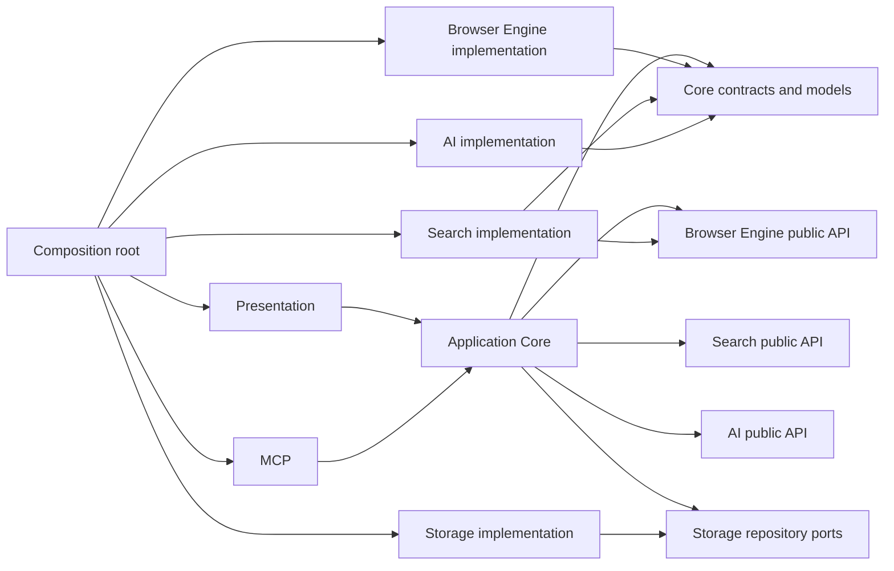

# STEP 2.1: Module responsibilities and dependency direction

## Architectural decision

Serox remains one Maven module as decided in
[ADR 0001](../decisions/0001-maven-module-strategy.md). Internal modules are
Java package boundaries with public interfaces. Split them into Maven modules
only when the extraction criteria in ADR 0001 are met.

## Responsibilities

<!-- markdownlint-disable MD013 -->
| Logical module | Owns | Must not own |
| --- | --- | --- |
| Presentation | JavaFX views, view state, accessible labels, and rendering application state | HTTP, HTML parsing, SQLite, API credentials, or provider implementations |
| Application Core | Browser lifecycle, tab/session state, navigation decisions, use-case orchestration, and public application events | JavaFX controls, parser/layout internals, SQL, or provider-specific request formats |
| Browser Engine | Network boundary, URL/request policy, document parsing, DOM, CSS, layout, and rendering | UI controls, search-provider ranking, AI prompts, or persistence implementation |
| Search | Search-provider adapter, query/result coordination, result normalization, page-fetch and content-extraction policy | Browser UI, AI prompt construction, MCP transport, or database details |
| AI | Provider adapters, context limits/filtering, answer generation, citation validation, and conversations | UI controls, arbitrary browser commands, or direct database access |
| MCP Server | MCP lifecycle, tool registration, input validation, authorization, and structured tool output | Direct access to UI controls, browser internals, credentials, or repositories |
| Storage | Local persistence adapters for history, bookmarks, sessions, settings, conversations, and cache | UI behavior, navigation policy, search/AI orchestration, or MCP authorization |
| App composition root | Construct concrete adapters, inject public ports, and start/stop the application | Product decisions or duplicate business rules |
<!-- markdownlint-enable MD013 -->

The composition root is the only package allowed to know the concrete
implementations of all adapters. Other modules depend on public ports and
immutable boundary models. Shared immutable models belong in
`kr.soyuo.serox.core.model`. Repository ports belong in
`kr.soyuo.serox.core.port.storage`; other public ports live with the logical
module that owns them. Implementation packages remain private to that module.

## Allowed dependency graph

## Dependency rules

1. Presentation issues commands through Application Core public APIs and
   renders events/state snapshots. It never calls an engine implementation.
2. Application Core coordinates modules and owns browser lifecycle state. It
   calls public module ports and translates results into application events.
3. Browser Engine exposes document/navigation capabilities through an API;
   its parser and renderer implementation remain private to the engine.
4. Search uses the Browser Engine's network/page access API for page fetching.
   The search provider stays behind `SearchProvider`.
5. AI receives bounded page/evidence models from Application Core. It does not
   query browser internals or Search implementation classes directly.
6. MCP invokes application use cases. `AccessController` validates each call
   before forwarding; MCP transport types do not cross into engine packages.
7. Storage implements repository ports. Only application use cases may request
   persistence; domain and presentation code do not issue SQL.
8. No module depends on Presentation or the composition root. No pair of
   implementation packages may reference each other in both directions.
9. Network, parsing, search, AI, and storage work run outside the JavaFX
   Application Thread; only presentation state application runs on that thread.

## Cross-module request flow

The dependency graph is compile-time direction, not a runtime sequence. A
search request starts in Presentation, enters Application Core, then calls the
Search API. Search may fetch pages through the Browser Engine API. Application
Core may pass the resulting bounded evidence to AI. Storage is accessed only
through repository ports, and UI updates return through application events.
This keeps direct navigation usable when Search, AI, MCP, or Storage fails.
